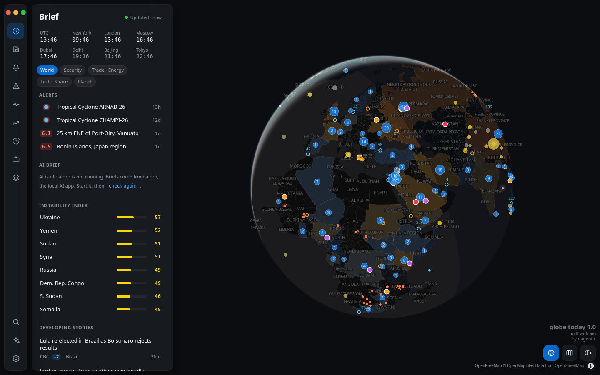

# Globe Today

What is happening in the world, on one 3D globe: news, disasters, severe weather, sirens, protests, military aircraft,
shipping, infrastructure, markets and prediction odds, plus live TV and optional local AI briefs.

Free. No account, no API keys, no tracking, no backend — it runs on your computer and reads public sources directly.

## Features

- 🌍 Globe, flat map and true-size (Equal Earth) map; country instability index; travel advisories
- 📰 59 news feeds clustered into stories; watchlists that alert on keywords
- ⚠️ Earthquakes, cyclones, floods, fires, weather warnings, rocket sirens, aviation emergencies, GPS jamming
- 📈 Markets, crypto, rates, central banks, Polymarket and Kalshi odds, market signals
- 📺 Live TV channels; reader that hides ads and cookie walls
- 🤖 AI briefs and translation into 40 languages through [aipro](#local-ai), a local AI app (optional)

## Run

Needs [Deno](https://deno.com) ≥ 2.9 and [aio](https://github.com/riagentic/aio) (`am`).

    git clone https://github.com/riagentic/gt && cd gt
    am fix              # links aio, installs Electron
    deno task dev       # opens the app
    deno task compile   # → dist/globe-today-<version>-x86_64.AppImage
    deno task test

App data lives in `~/.gt`.

**Tests:** 82 (`deno task test`), all passing on Linux. Run locally; there is no CI yet.

## Local AI

Briefs and translations come from aipro, an aio app that runs AI models on your computer. Without it Globe Today works
fully; AI features just stay off. Nothing is sent to a cloud AI.

## Sources

All keyless and public: USGS, NASA EONET, GDACS, NWS, Environment Canada, WMO, WHO, ReliefWeb, ECDC, Safecast,
Open-Meteo (ERA5), NOAA, adsb.lol, FAA, Tzeva Adom, gpsjam.org, CelesTrak, GDELT, US State Department, World Bank,
UNHCR, OFAC, IMF, IMF PortWatch, BIS, Yahoo Finance, CoinGecko, CNN, US Treasury, NY Fed, ECB, CFTC, Polymarket, Kalshi,
TeleGeography, Element 84 (Sentinel-2) and the RSS feeds in `src/data/feeds.ts`.

Map: [OpenFreeMap](https://openfreemap.org) © OpenMapTiles, data © OpenStreetMap contributors · Natural Earth · Wikidata
(CC0) · NGA World Port Index · [newzealandpaul/Shipping-Lanes](https://github.com/newzealandpaul/Shipping-Lanes) (CC BY
4.0).

Data is shown as is and can be late or wrong. Not for safety decisions — follow official warnings.

## License

[MIT](LICENSE) © 2026 riagentic
